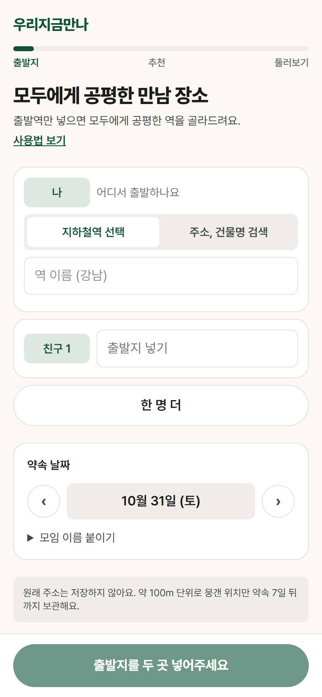
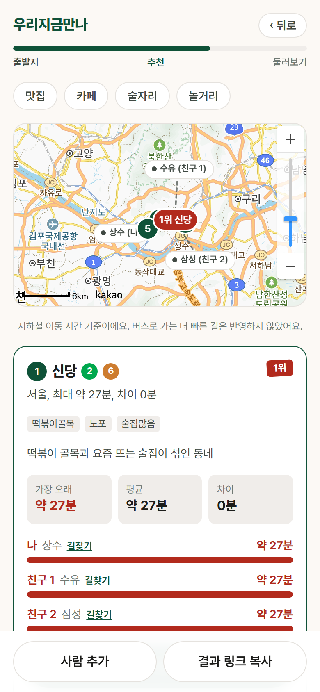
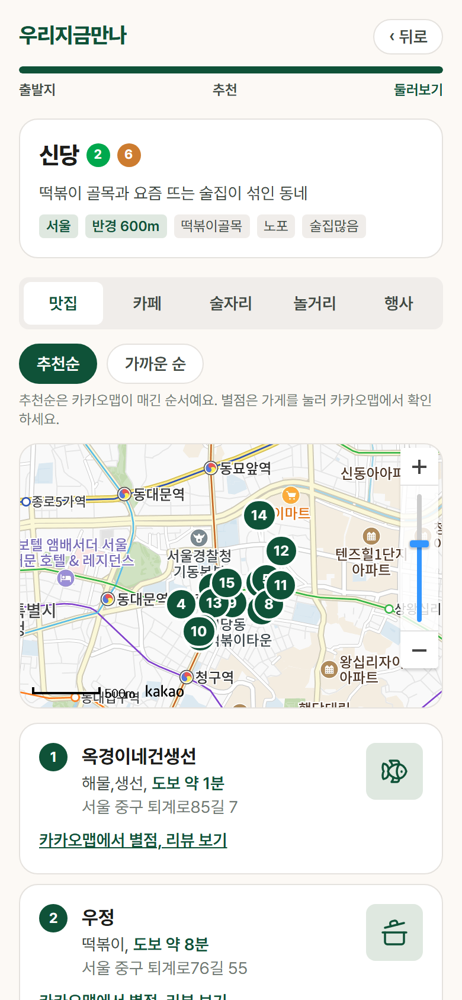

# 우리지금만나

친구들이 각자 출발역을 넣으면 모두에게 공평한 만남 장소를 골라 주는 웹 서비스입니다. 수도권 지하철 기준으로 가장 오래 걸리는 사람의 이동 시간이 가장 짧은 동네를 추천하고, 그 동네의 맛집, 카페, 술집, 놀거리, 행사를 함께 보여 줍니다.

**https://meetpoint-kappa.vercel.app**

가입은 없습니다. 출발지를 넣고 "추천 보기"를 누르면 방 링크가 생기고, 링크를 받은 친구가 자기 출발지를 더하면 추천이 다시 계산됩니다.

<table>
  <tr>
    <td align="center"></td>
    <td align="center"></td>
    <td align="center"></td>
  </tr>
  <tr>
    <td align="center">출발지 넣기</td>
    <td align="center">추천 결과</td>
    <td align="center">동네 둘러보기</td>
  </tr>
</table>

## 추천 방식

1. 참여자마다 출발역을 정합니다. 역을 직접 고르면 그 역이고, 주소로 넣으면 가까운 역 최대 3곳 중 가장 빨리 가는 쪽을 씁니다.
2. 거점 후보마다 참여자별 지하철 이동 시간을 구하고 하차 후 도보 5분을 더합니다.
3. **가장 오래 걸리는 사람의 시간**이 짧은 순서로 줄을 세웁니다. 같으면 모두의 시간 합이 작은 쪽이 앞입니다.
4. 테마(맛집, 카페, 술자리, 놀거리)를 고르면 1위보다 5분 이내로 더 걸리는 거점 중 테마에 맞는 곳을 앞으로 올립니다.
5. 상위 5곳을 사람별 이동 시간, 가장 오래 걸리는 사람과 가장 빨리 오는 사람의 차이와 함께 보여 줍니다.

이동 시간은 실시간 길찾기가 아니라 미리 계산해 둔 역간 시간표에서 꺼냅니다. 1~8호선은 서울교통공사가 공개한 역간 운행시간에 정차 시간을 더했고, 나머지 노선은 역간 거리를 노선 종류별 평균 속도로 나눴습니다. 환승은 실측 환승 도보 시간에 대기 2.5분을 더합니다(실측이 없으면 4분). 근거는 [backend/data/SOURCES.md](backend/data/SOURCES.md)에 있습니다.

### 하지 않는 것

- 버스와 도보 경로는 계산하지 않습니다. 지하철 이동 시간만 봅니다.
- 환승 횟수와 노선 안내는 없습니다. 사람마다 붙은 "길찾기"는 카카오맵 길찾기로 연결됩니다.
- 가게 목록은 추천순(카카오의 정확도순)과 가까운 순만 있습니다. 별점순과 리뷰순은 그 데이터를 주는 공식 API가 없어 만들지 않았습니다.
- 추천 거점은 서울 안의 63곳입니다. 경기, 인천에서 출발하는 사람도 넣을 수 있지만 만나는 곳은 서울 안에서 나옵니다.

### 개인 정보

- 입력한 주소 원문은 저장하지 않습니다. 좌표는 소수점 3자리(약 100m)로 뭉개서 저장합니다.
- 다른 참여자에게는 가까운 역 이름만 보입니다.
- 방과 참여자 데이터는 약속 날짜 7일 뒤에 지워집니다.
- 익명 이용 통계(Amplitude)에는 닉네임, 출발역, 주소, 좌표, 방 링크를 보내지 않습니다. 보내는 값은 [개인정보 안내](https://meetpoint-kappa.vercel.app/privacy)에 적어 두었습니다.

## 기술 구성

| 영역 | 사용한 것 |
|---|---|
| 프론트엔드 | Next.js 16 (App Router), React 19, TanStack Query, 카카오맵 JavaScript SDK |
| 백엔드 | Python 3.12, FastAPI, SQLAlchemy 2.0, httpx |
| DB | PostgreSQL (Supabase). 로컬과 테스트는 SQLite |
| 배포 | 프론트 Vercel, 백엔드 Render, `main`에 합쳐진 커밋이 CI를 통과하면 자동 배포 |
| 테스트 | pytest와 respx, Vitest와 MSW, Playwright 흐름 테스트, GitHub Actions |
| 외부 API | 카카오 로컬(주소 검색, 가게 목록), 서울 열린데이터광장 문화행사, KOPIS 공연 정보 |

브라우저가 FastAPI를 직접 부르고 결과 화면은 10초마다 다시 읽어 친구가 들어오면 추천이 바뀝니다. 역간 시간표는 서버가 처음 계산할 때 메모리에 올려 두고 씁니다.

## 폴더 구조

```
backend/
  app/            FastAPI 서버. 라우터는 얇게, 로직은 서비스에
    rooms/          방과 참여자, 추천 결과
    ranking/        거점 순위 매기기
    transit/        역간 시간표 조회
    geocoding/      주소를 좌표로, 가까운 역 찾기
    places/         맛집, 카페, 술집, 놀거리
    events/         행사와 공연
  pipeline/       공공데이터를 역, 역간 시간표, 거점 CSV로 바꾸는 단계별 스크립트
  data/           원본(raw), 손으로 고친 거점 목록(manual), 결과 CSV(out)
  migrations/     운영 DB 구조 변경 SQL
  tests/
frontend/
  app/            경로. URL을 읽어 화면 컴포넌트에 넘기기만 한다
  components/     화면 로직 (home, join, result, hub)
  lib/            API 호출, 문구, 통계, 예시 방 데이터
  e2e/            Playwright 흐름 테스트
docs/             설계 문서
dev/active/       작업별 계획, 결정, 체크리스트
```

## 로컬에서 실행하기

백엔드를 먼저 띄우고 프론트엔드를 띄웁니다. 자세한 순서와 환경 변수는 각 폴더의 README에 있습니다.

- [backend/README.md](backend/README.md): 가상환경 설치, DB 만들기와 데이터 적재, 테스트, 배포와 운영
- [frontend/README.md](frontend/README.md): 개발 서버, 단위 테스트와 흐름 테스트, 타입 생성

```bash
cd backend
.venv/Scripts/uvicorn app.main:app --reload    # http://localhost:8000/docs
```

```bash
cd frontend
npm run dev                                     # http://localhost:3000
```

설계 결정은 [docs/design.md](docs/design.md), 데이터 파이프라인은 [docs/transit-data-design.md](docs/transit-data-design.md), 배포 구성은 [docs/deploy-design.md](docs/deploy-design.md)에 있습니다.

## 데이터 출처

본 서비스는 국가철도공단, 서울교통공사가 제공한 공공데이터를 이용합니다.

- 역 위치와 노선: 국가철도공단 전국도시철도역사정보표준데이터
- 1~8호선 역간 운행시간과 환승 도보 시간: 서울교통공사
- 그 밖의 노선 역간 거리: 국가철도공단 노선별 역간거리 (9호선, 신분당선, 수인분당선, 경의중앙선, 공항철도 등)

수도권 24개 노선, 역 646곳(환승역은 하나로 셉니다)을 다룹니다. 파일별 출처, 받은 날짜, 라이선스, 원본 결함을 고친 내역은 [backend/data/SOURCES.md](backend/data/SOURCES.md)에 있습니다.

가게 정보는 카카오 로컬 API, 행사는 서울 열린데이터광장과 공연예술통합전산망(KOPIS)에서 가져와 하루 동안 캐시합니다.
